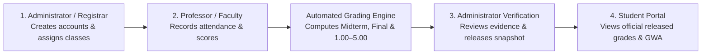

# GRC Three-Role Grading System — Complete Persona & Live Demo Guide

This guide is designed for system presenters, faculty, and evaluators. It explains **what the system automates**, the **exact responsibilities of each persona (Administrator, Professor, Student)**, the **step-by-step live demo script**, and **answers to common defense/panel questions**.

---

## 1. System Overview & Automation Summary

The **GRC Three-Role Grading System** is an automated, role-based academic grading and verification portal built for **Global Reciprocal Colleges (GRC)**. It connects three personas through a strict, auditable workflow:

### What Is Automated?
1. **Automatic Account IDs & School Emails:** Creating an account automatically generates a role-based ID (`ADMIN-YYYY-MM-#####`, `PROF-YYYY-MM-#####`, `STUD-YYYY-MM-#####`) and institutional `@grc.edu.ph` email address.
2. **Pre-Configured GRC Grading Setup:** When the Administrator assigns a class to a professor, the system automatically initializes:
   - **Midterm (50%) & Final (50%)** period structure
   - **Standard Criteria Weights (100% per period):** Attendance (`15%`), Recitation (`15%`), Assignment (`15%`), Quizzes (`25%`), and Major Exam (`30%`)
   - **Passing Threshold (`75%`)** and the official **GRC `1.00` to `5.00` Grade Conversion Table**
3. **1-Click Daily Attendance:** Clicking **"Take attendance today"** creates today's meeting and marks all active students **Present** (`5/5` points) by default—the professor only clicks `Late`, `Absent`, or `Excused` for exceptions.
4. **Online Attendance Auto-Matching:** Uploading a CSV or Google Meet Attendance Tracker PDF automatically matches students by Student Number or Email and calculates `Present`, `Late`, or `Absent` based on minutes attended.
5. **Single-Input Score Encoding:** Professors type a number (`0` to `Max`), `M` (Missing), `E` (Excused), or leave blank (Not Graded), or use 1-click quick pills (`Max`, `M`, `E`, `Clear`, and `Fill ungraded with max`).
6. **Real-Time Grade & GWA Computation:** Midterm, Final, Course Grade, `1.00–5.00` equivalent, `Passed`/`Failed` remarks, and the student's Term Weighted Average are computed automatically.
7. **No-Duplicate-Subject Rule:** Just like the enrollment system (`SMS_WebSys`), a student cannot be enrolled in two sections (e.g., `BSIT-1A` and `BSIT-1B`) of the same `subject_code` in the same academic term.

---

## 2. Trabaho ng Kada Persona (Role-by-Role Guide)

### Persona 1: Administrator / Registrar (`registrar.php`)
> **Pangunahing Trabaho:** Tagapamahala ng accounts, taga-assign ng subjects/sections sa mga professors, at taga-verify at release ng official grades papunta sa mga estudyante.

| Feature / Menu | Ano ang Ginagawa ni Admin? | Bakit Mahalaga? |
|---|---|---|
| **Dashboard** | Tinitingnan ang bilang ng Students, Faculty, Classes, at mga **Grade sheets for review** o **Account approvals**. | Nakikita agad sa isang tingin kung may pending na gawain. |
| **Accounts** | Gumagawa ng Faculty, Student, at Admin accounts; nag-a-approve ng access; at nag-i-issue ng **24-hour one-time activation/reset code**. | Walang hardcoded password na sine-send sa email; ang user mismo ang magse-set ng sarili niyang password gamit ang one-time code. |
| **Classes & grades** | Gumagawa ng **Class Offering** (Subject, Section, Units, Term) at ina-assign ito sa active Professor. | Hindi na mahihirapan ang Professor mag-set up ng klase at grading formula dahil pre-configured na pagka-assign ni Admin. |
| **Student Masterlist & Review** | Binubuksan ang klase para tingnan ang enrolled students, individual grade breakdown, at **Grade sheet actions**. | Dito chine-check ni Admin ang ebidensya bago i-click ang **Release complete grade sheet** o **Return / reopen for correction**. |
| **Reassign Professor** | Naglilipat ng draft class sa ibang active professor kapag nagpalit ng guro. | Nananatili lahat ng enrolled students, attendance, at scores kahit mapalitan ang professor. |
| **Activity Log & Backup** | Tinitingnan ang read-only **Audit Trail** ng lahat ng galaw sa system at nagda-download ng **Recovery Backup (`.json`)**. | Kumpletong accountability at disaster recovery. |

---

### Persona 2: Professor / Faculty (`professor-dashboard.php`)
> **Pangunahing Trabaho:** Magtala ng attendance at scores ng kanyang mga klase at mag-submit ng kumpletong grade sheet sa Registrar.

| Tab sa Loob ng Klase | Ano ang Ginagawa ni Professor? | Paano Ito Pinadali / Automated? |
|---|---|---|
| **1. Students (`roster`)** | Nagdadagdag o nagda-drop/restore ng students sa klase. | **Bulk Paste:** Ipe-paste lang ang listahan ng Student Numbers (isang bagsakan). Automatic ding bina-block kung nasa ibang section na ng parehong subject ang student. |
| **2. Attendance (`attendance`)** | Nagche-check ng attendance kada meeting (Face-to-face o Online Import). | **1-Click "Take attendance today":** Present na agad lahat (`5 pts`); 1-click pill buttons (`Present`, `Late`, `Absent`, `Excused`) na lang ang pipindutin. Puwede ring mag-import ng CSV/Meet PDF. |
| **3. Scores (`activities`)** | Gumagawa ng Quiz, Recitation, Assignment, o Major Exam at naglalagay ng scores. | **Single-Input Score Sheet:** Isang input box kada student (`0–Max`, `M` = Missing, `E` = Excused) + `Max` / `M` / `E` / `Clear` buttons + **Fill ungraded with max**. |
| **4. Grades (`grades`)** | Chine-check ang auto-computed Midterm, Final, at Course Grade bago i-submit sa Registrar. | Kung may nakalimutang i-grade na student, sasabihin mismo ng system kung aling criterion ang may pending at may **direct shortcut button** papunta roon. |
| **5. Settings (`settings`)** | Ina-adjust ang criteria weights, attendance points, o nagko-copy ng setup mula sa ibang klase. | May **Live Total Weight Counter (`100%`)** at **1-Click Copy Setup** mula sa ibang klase ni Prof. |

---

### Persona 3: Student (`student-dashboard.php`)
> **Pangunahing Trabaho:** Tingnan ang kanyang official released grades, Term Weighted Average (GWA), at ang detalyadong computation/ebidensya ng kanyang marka.

| Bahagi ng Student Portal | Ano ang Nakikita ng Student? | Proteksyon at Privacy |
|---|---|---|
| **Academic Term Summary** | Bilang ng Enrolled Subjects, Released Units, at **Term Weighted Average**. | Tanging **released** subjects lang ang sinasama sa computation ng average. |
| **My Subjects Table** | Listahan ng kanyang mga subjects sa napiling semester, Midterm, Final, Course `%`, Converted (`1.00–5.00`), at Status (`Passed`, `Failed`, o `Awaiting released grade`). | **Walang Duplicate Subjects:** Isang section lang kada subject sa isang semester. Hindi rin makikita ng student ang draft changes hangga't hindi nire-release ni Admin. |
| **Released Subject Record** | Kapag pinindot ang view icon sa isang released subject, lalabas ang bawat criterion (`Midterm · Attendance`, `Quizzes`, `Major Exam`, atbp.) at bawat meeting/activity score niya. | Alam agad ng student kung bakit ganoon ang nakuha niyang grade nang hindi nakikita ang record ng ibang kaklase. |
| **Print & CSV Report** | Puwedeng i-print ang term results o i-download ang official CSV/printable report. | May official GRC formatting at signature lines para sa beripikasyon. |

---

## 3. Demo Accounts & Sign-In Credentials

Lahat ng users ay pumapasok sa **iisang sign-in page**:  
`http://localhost/GRC_Three_Role_Grading_System-main/index.php`

| Persona / Role | Pangalan | Username / School ID / Email | Password |
|---|---|---|---|
| **Administrator** | Ryan Kirby Corigal | `admin` o `ADMIN-2026-11-00001` | `Admin@GRC2026` |
| **Administrator (Demo)** | Regina Mae Castillo | `demo.admin` | `GrcDemo!2026` |
| **Professor (CCS / IT)** | Prof. Adrian Miguel Dela Cruz | `demo.faculty.ccs` o `adrian.miguel.dela.cruz@grc.edu.ph` | `GrcDemo!2026` |
| **Professor (CCS Sec B)** | Prof. Angela Marie Villanueva | `demo.faculty.ccs2` o `angela.marie.villanueva@grc.edu.ph` | `GrcDemo!2026` |
| **Professor (COA / Acct)** | Dr. Elena Patricia Reyes | `demo.faculty.coa` o `elena.patricia.reyes@grc.edu.ph` | `GrcDemo!2026` |
| **Professor (COE / Educ)** | Prof. Rafael Antonio Mendoza | `demo.faculty.coe` o `rafael.antonio.mendoza@grc.edu.ph` | `GrcDemo!2026` |
| **Student (May Released Grade)** | Miguel Angelo Soriano | `demo.student17` o `STUD-2026-11-00017` | `GrcDemo!2026` |
| **Student (BSIT 1st Year)** | Gabriel Luis Dela Cruz | `demo.student03` o `STUD-2026-11-00003` | `GrcDemo!2026` |

---

## 4. Step-by-Step Live Demo Script (5–7 Minutes)

Sundin ang pagkakasunod-sunod na ito habang nagpe-present:

### Step 1: Shared Sign-In Page (`index.php`)
- **Ipakita:** Buksan ang `index.php`.
- **Sabihin:** *"Isa lang ang sign-in page para sa Admin, Professor, at Student. Puwedeng gamitin ang School ID, Institutional Email (`@grc.edu.ph`), o Username. Kusa nang dine-detect ng system kung anong role at workspace ang bubuksan."*

### Step 2: Administrator — Dashboard, Accounts & Class Assignment (`demo.admin`)
1. Mag-sign in bilang **`demo.admin`** (Password: **`GrcDemo!2026`**).
2. **Dashboard:** Ipakita ang 4 stat cards (*Students*, *Faculty*, *Classes*, *Grade sheets for review*) at ang *Needs attention* panel.
3. **Accounts:** Pumunta sa **Accounts** -> ipakita ang pill tabs (*Faculty*, *Students*, *Administrators*) -> buksan ang isang account (`Manage account`) para ipakita na automatic ang Account ID (`PROF-YYYY-MM-#####`) at may **Issue one-time code** para sa secure activation/password recovery.
4. **Classes & grades:** Pumunta sa **Classes & grades** -> buksan ang **Create a class and assign a professor** sa ibaba para ipakita na si Admin ang nag-a-assign ng subject at section kay Professor, at automatic nang sine-set up ng system ang GRC grading criteria.

### Step 3: Professor — Automated Attendance, Scores & Grades (`demo.faculty.ccs`)
1. Mag-sign out at mag-sign in bilang **`demo.faculty.ccs`** (Password: **`GrcDemo!2026`**).
2. **My classes:** Pumili ng klase (hal. **`ITFUNDL · IT Fundamentals Laboratory`**) -> pindutin ang **Open class**.
3. **Students Tab:** Ipakita na nasa iisang unified workspace header at pill-tab navigation ang lahat ng tools ni Prof. Ipakita ang **Add students** kung saan puwedeng mag-paste ng listahan ng student numbers at bina-block ng system ang duplicate subjects sa parehong term.
4. **Attendance Tab:**
   - Pindutin ang **"Take attendance today"** -> ipakita na gawa agad ang meeting ngayong araw at **Present** na agad lahat ng 41 students!
   - Mag-click ng `Late`, `Absent`, o `Excused` pill button sa ilang students para ipakita na 1-click lang at nag-a-update agad ang live counter sa itaas, tapos pindutin ang **Save attendance**.
5. **Scores Tab:**
   - Mag-create o magbukas ng isang Quiz/Activity.
   - Ipakita ang **Single-Input Score Sheet**: mag-type ng score, o pindutin ang quick buttons (`Max`, `M` para sa Missing, `E` para sa Excused, o **Fill ungraded with max**), tapos i-click ang **Save scores**.
6. **Grades Tab:**
   - Ipakita na automatic nang kinuwenta ang **Midterm**, **Final**, at **Course Grade** kasama ang GRC `1.00–5.00` equivalent.
   - Kung may kulang pang score, ipakita ang clickable warning buttons na direktang nagdadala kay Prof sa kulang na criterion. Kapag kumpleto na lahat, pipindutin lang ang **Submit complete grade sheet to Registrar**.

### Step 4: Administrator — Verification & Grade Release (`demo.admin`)
1. Mag-sign in ulit bilang **`demo.admin`**.
2. Pumunta sa **Classes & grades** -> buksan ang isang submitted class (hal. **`ACTG101 · Financial Accounting and Reporting 1`**) -> pumunta sa **Grade sheet actions** tab.
3. Ipakita na puwedeng i-review ni Admin ang individual student breakdown sa masterlist, i-download ang reports, i-return for correction kung may mali, o pindutin ang **Release complete grade sheet** para i-publish ang official grades.

### Step 5: Student — Official Released Grades & Evidence (`demo.student17`)
1. Mag-sign in bilang **`demo.student17`** (Password: **`GrcDemo!2026`**).
2. **My academic record:** Ipakita ang Term Weighted Average, Released Units, at ang **My subjects** table (walang duplicate subjects).
3. Pindutin ang view icon sa **`EDUC101`** para ipakita ang **Released Subject Record** at ang pill tabs ng bawat criterion (`Midterm · Attendance`, `Recitation`, `Quizzes`, atbp.) kung saan makikita ng student ang bawat recorded score niya at puwede siyang mag-print o mag-download ng CSV report.

---

## 5. Defense Q&A — Mga Madalas Itanong at Eksaktong Sagot

1. **Q: Paano kino-compute ng system ang grades?**
   - **Sagot:** Hinahati ang course grade sa **Midterm (50%)** at **Final (50%)**. Sa loob ng bawat period, ang default GRC weights ay **Attendance (15%)**, **Recitation (15%)**, **Assignment (15%)**, **Quizzes (25%)**, at **Major Exam (30%)** = **100%**. Ang passing threshold ay **75%** (katumbas ng **3.00** sa GRC `1.00–5.00` scale).
2. **Q: Ano ang pinagkaiba ng `0`, `Missing (M)`, `Excused (E)`, at `Not Graded (Blank)`?**
   - **Sagot:**
     - **`Scored 0`:** Nagpasa o kumuha ng exam ang student pero zero ang nakuha (`0 / Max`). Kumpleto ang record at kasama sa computation.
     - **`Missing (M)` at `Not Graded (Blank)`:** Hindi pa tapos o wala pang naitalang marka. Hina-harang ng system ang pag-submit ng grade sheet hangga't hindi nare-resolve ang mga ito para walang aksidenteng ma-zero nang hindi sinasadya.
     - **`Excused (E)`:** Depende sa class setting, puwedeng *excluded* sa total possible points ng student para hindi bumaba ang kanyang percentage.
3. **Q: Bakit hindi nagdo-doble ang subject ng isang student?**
   - **Sagot:** Sinusunod ng system ang enrollment rule ng `SMS_WebSys`: sa isang school year at semester, isang active section lang kada `subject_code` ang puwedeng kunin ng student. Kapag sinubukang i-enroll ang student sa pangalawang section (hal. nasa `BSIT-1A` na tapos idadagdag sa `BSIT-1B`), awtomatikong hina-harang o sini-skip ito ng system.
4. **Q: Paano kung may kailangang itama si Professor pagkatapos ma-release ang grades?**
   - **Sagot:** Gumagamit ang system ng **Immutable Release Snapshots**. Puwedeng i-click ni Admin ang **Return / reopen for correction** (may required reason sa audit log). Habang ine-edit ni Prof ang draft, ang nakikita ng student ay nananatiling yung naunang official released snapshot hangga't hindi ulit nire-release ni Admin ang bagong version.

