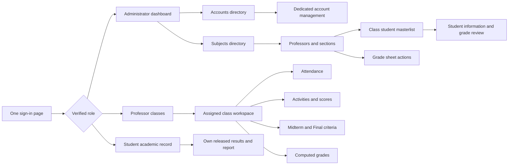
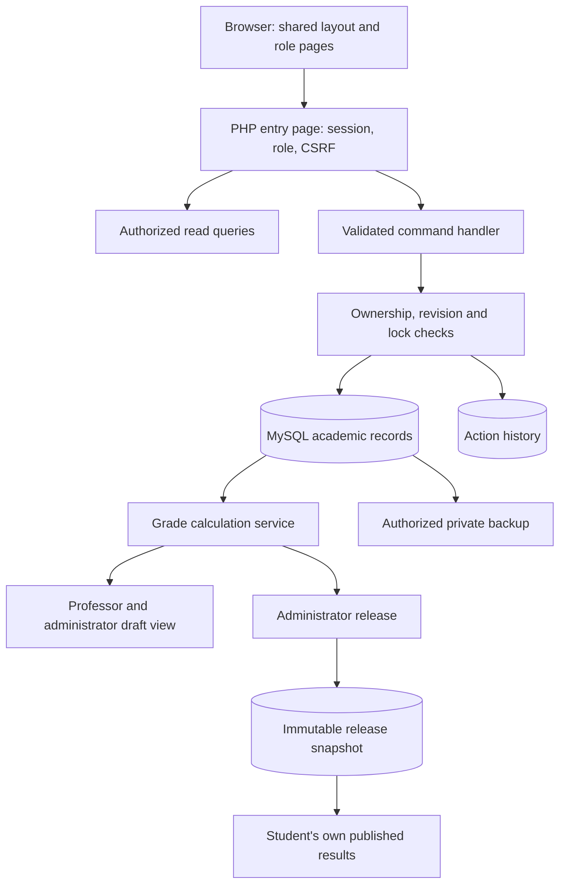
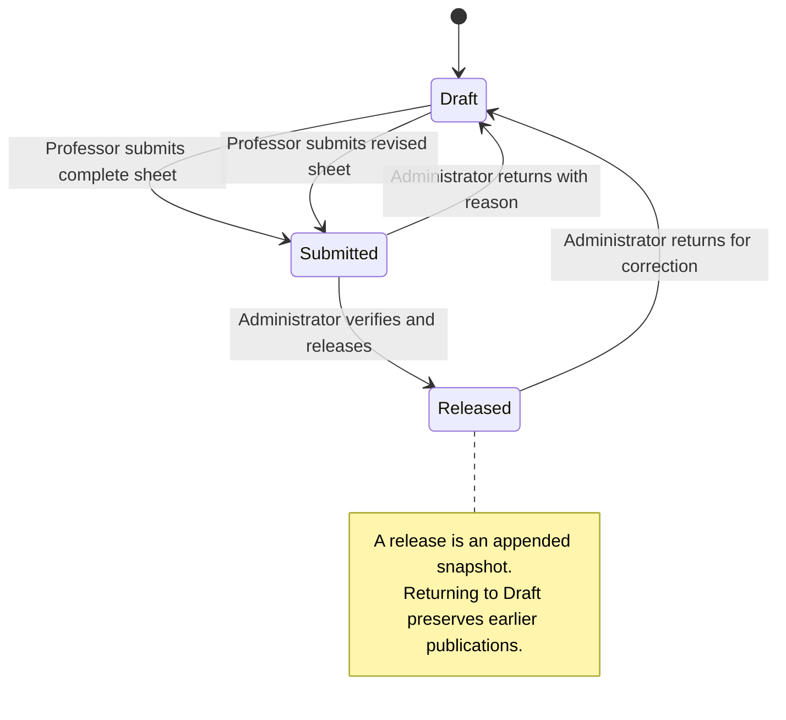

# GRC grading system architecture and revision plan

Editable working reference, 3 November 2026. This describes the PHP system in this project and the checks needed before calling the revision finished. The enrollment system at `C:\xampp\htdocs\SMS_WebSys` supplies the visual reference; it is a separate application and database.

## Product structure

Use a directory followed by a dedicated detail page, as in the enrollment system's dashboard, manage students and student information. People should see the available subjects, classes or students before opening one record. Primary navigation and per-record management should not depend on opening a dropdown or an accordion.

The header uses the GRC wordmark and crimson institutional color. Shared local Inter fonts, consistent panel spacing, visible form labels and clear action names apply to all three personas. Inside a table, the Action column may use labeled icons. Outside tables, actions such as Reassign professor and Confirm reassignment need visible text.

Dropdowns remain suitable for bounded form choices such as a department, a work status or an attendance status. This does not make them substitutes for the directory/detail navigation above. Any remaining class-selection or evidence accordion is a revision target when it hides the main workflow.

## Implementation layers

| Layer | Current files | Responsibility |
|---|---|---|
| Entry and authentication | `index.php`, `includes/auth.php`, `includes/unified_auth.php`, `includes/security.php`, `includes/portal.php` | One sign-in flow, session validation, active account checks, role routing, CSRF and security headers |
| Shared presentation | `includes/portal.php`, `includes/page_paint.php`, `assets/css/classbook.css`, `assets/css/workspace.css`, `assets/css/administrator.css`, `assets/js/classbook.js` | Header/sidebar, typography, first paint, navigation, automatic filters and common controls |
| Administrator pages | `registrar.php`, `includes/admin_views.php`, `includes/admin_presentation.php`, `includes/subject_directory.php`, `manage-account.php`, `reassign-class.php` | Account directory/detail, subject directory, verification, release, reassignment and audit visibility |
| Class and student detail | `class.php`, `student-review.php`, `includes/student_review.php`, `assets/css/class-workspace.css`, `assets/css/grade-review.css`, `assets/css/faculty-records.css` | Masterlist, filter context, one selected student and visible period grade breakdown |
| Professor pages | `professor-dashboard.php`, `includes/faculty_views.php`, `includes/faculty_records.php`, `includes/faculty_extras.php` | Assigned classes, criteria, individual attendance and assessment records, formulas and submission |
| Domain commands | `includes/classbook_actions.php`, `includes/admin_actions.php` | Validated transactional changes, ownership checks, revision checks and audit entries |
| Grade calculation | `includes/classbook.php`, `includes/grading_periods.php`, `includes/shared_exams.php` | Eligible records, category aggregation, period weights, course grade and canonical major exams |
| Attendance import | `includes/attendance_report.php`, import actions in `includes/classbook_actions.php` | Parse supported reports, preview identity matching and statuses, commit reviewed records once |
| Publication and reporting | Release functions in `includes/classbook.php`, `student-dashboard.php`, `report.php` | Immutable published snapshots, student's own released view, CSV and printable reports |
| Persistence and recovery | `includes/db.php`, `database/*.sql`, `includes/backup.php`, `backup-download.php` | Prepared queries, schema upgrades, academic backup and empty-database restoration |

## Input, process and output

| Stage | Inputs | Automated process | Output and human decision |
|---|---|---|---|
| Attendance | Class meeting/date, enrollment starts, Present/Late/Absent/Excused; or supported CSV/PDF report | Validate the meeting and eligible students; convert statuses to configured points; retain imported duration/source; reject duplicate imports | Meeting attendance and points. Professor reviews report identities and statuses before commit |
| Assessment | Activity, maximum points, student score and work status | Validate scores against maximum; keep scored zero, Missing, Not graded and Excused distinct | Per-student evidence. Professor records the observed work rather than supplying only an overall grade |
| Category | Individual eligible records, professor-selected pooled or equal aggregation, excused rule | Compute total earned/possible or the mean of activity percentages | Category percentage, with incomplete work retained as incomplete |
| Period | Midterm or Final criteria and weights totaling 100% | Multiply category percentages by criterion weights | Midterm percentage and Final percentage |
| Course | Period percentages, configured period shares, passing threshold and optional conversion bands | Blend the two period percentages and apply configured labels | Draft course grade and remarks |
| Verification | Complete draft grade sheet and evidence | Check completeness, retain revision and lock submitted edits | Administrator reviews and releases, or returns for correction |
| Publication | Verified calculation, class identity, policy and student evidence | Append a release snapshot rather than replacing the previous publication | Student sees only their own released result; later draft corrections do not silently change it |

Present earns 5 points per eligible meeting. Late may earn 3 or 5 according to the professor's rules; Absent and online full/partial time thresholds are configured per class. Excused work follows the configured exclude-or-make-up rule. Recitation and activities use the professor's stated maximum, so the system does not assume every activity is out of 10 or 100.

A category's weighted contribution is its percentage multiplied by its category weight divided by 100. For example, full attendance earns the full 15% contribution when Attendance has a 15% weight. Different category weights remain professor-controlled and must total 100% per period.

The active period model uses **Midterm and Final**. Lecture and laboratory may be distinct subjects in the catalog; they are not duplicated grading groups in this model. Each subject has one canonical Prelim, Midterm and Final exam score sheet. Retained legacy components and old duplicate exam rows remain available for preservation but are excluded from active period calculations.

## Security and data boundaries

- One login resolves the persona from verified credentials. A role chosen by an untrusted request does not grant access.
- `portalUser()` rechecks the persisted account status and credential signature. Idle and maximum session lifetimes are enforced.
- Professors can access only classes assigned to their account. Administrators verify all classes. Students receive only their own published data.
- POST commands require CSRF validation. Authoritative class IDs on dedicated class/reassignment routes come from the authorized URL, rather than trusting a hidden target field.
- `cbWrite()` locks the class settings row, validates the expected revision and ownership, and rejects edits to submitted/released/archived records unless an authorized state transition applies.
- Score, attendance, identity and policy changes use validation and transactions. Failure rolls the whole operation back, preventing a partially saved class record.
- Publication checks complete positively weighted criteria and stores the class, policy and results together. Student reports filter the snapshot back to the signed-in student's identity.
- CSV exports escape spreadsheet formula prefixes. UI text is HTML-escaped through the shared helper.
- Account public IDs are allocated transactionally per role and creation month, with five-digit sequences. Legacy school identifiers remain separate when already in use.
- Action history records who changed a record and relevant reasons. It is an application audit trail, not a claim of tamper-proof external logging.
- Backups contain private academic and protected account data. Recovery accepts the declared backup format and requires an empty target database. Sessions and activation/reset tokens are excluded.

The enrollment system is a read-only design reference during this revision. Its records are not automatically synchronized with the grading database. Google Classroom/Meet OAuth integration is explicitly outside the present scope; supported report import is the implemented online attendance path.

## Build order and acceptance evidence

1. Inspect enrollment dashboard, manage students and student information and document the reusable layout patterns.
2. Apply the shared shell, typography, spacing and controls across all personas.
3. Use subject/class/student directories and dedicated detail pages; remove hidden primary actions and duplicate navigation.
4. Check real data states: long names, 40 students, empty/no-result lists, draft/submitted/released/archived classes, and pending/deactivated accounts.
5. Verify browser layout and controls on desktop and a small mobile viewport. Check keyboard focus and reduced motion.
6. Run domain and authenticated workflow regressions on disposable databases. Record limits separately from passes.

| Requirement | Authoritative evidence needed | Current evidence and remaining gate |
|---|---|---|
| Enrollment design relation | Current enrollment source plus screenshots compared with grading pages | Enrollment source comparison informed the shared dashboard, directory and information-page hierarchy. Browser checks cover subject → professor → masterlist → student navigation and visible account creation. |
| No hidden primary workflow | Actual subject → offering → masterlist → student route, visible action labels | Verified browser behavior: subject/professor/masterlist/review and back links; professor class cards and Change class; student read-only released detail. Activity and attendance directories open one visible sheet; final HTTP checks verify that saving an older, non-default sheet retains its selected ID and keeps creation/rules forms out of the focused view. |
| Aesthetic readable fonts and spacing | Rendered desktop/mobile views with long text and crowded controls | 38 page/viewport render cases across 19 pages passed status/overflow/error checks. A further 16 final reduced-motion renders verify local Inter, content width and light surfaces; account forms have measured field spacing with no overlap at 1366px and 375px. |
| Role, ownership, revisions and complete saves | Disposable-domain and HTTP tests | Fresh `tests/classbook_test.php`: **79 checks passed** on this review |
| Two periods and one major exam sheet | Current computation and period tests | Fresh `tests/period_grading_test.php`: **19 checks passed** on this review |
| Automatic account IDs under concurrency | Concurrent allocation test | Fresh `tests/account_ids_test.php`: **18 checks passed**, including five simultaneous allocations |
| Directory/detail filters, reassignment and full workflows | Fresh relevant authenticated HTTP tests after final UI changes | Fresh updated suites: **132 full workflow**, **42 subject flow**, **50 masterlist**, and **42 reassignment HTTP checks passed** |
| Student publication privacy | Release/correction tests and own-student report checks | Covered by the domain suite and fresh expanded HTTP suite, including selected released-subject evidence, invalid subject selection, own-student filtering and stable publication after draft correction |
| Browser behavior and accessibility | Pointer/keyboard exercise, mobile overflow inspection, contrast and motion checks | 15 browser behavior checks passed: 6 navigation/search/menu/publication cases, 3 account creation/spacing follow-ups, and 6 faculty attendance/activity directory and focused-sheet checks. Mobile menu Escape restores focus; automatic search preserves typing focus; controls were exercised without submitting live academic changes. These checks do not claim a complete accessibility certification. |
| Simultaneous duplicate offering changes | Concurrent creation, editing and reassignment must leave one offering for the target professor | Fixed using a shared transaction mutex and current-read duplicate checks; fresh `tests/class_offering_test.php`: **7 checks passed** across all three paths |

## Concurrent offering protection

Creating, editing and reassigning class offerings share the retained transaction mutex used by account identifier allocation. Each duplicate lookup uses `SELECT ... FOR UPDATE`, so a transaction that waited for another writer checks the latest committed rows even if an earlier read established an older snapshot. This protects the professor/subject code/section/school year/semester combination across the three application command paths without changing the live schema or deleting class records.

Before the fix, an isolated reproduction of two simultaneous identical creation requests passed both plain existence checks and inserted two classes. The regression test delays writes only inside its disposable database to make the overlap reproducible. After the fix, exactly one competing request saves and the other receives the existing duplicate-offering message. The same test exercises simultaneous edits and reassignments and checks that reassignment retains all class records.

This is application-level transaction protection. Direct database writes outside these command handlers must follow the same invariant. An optional future database uniqueness constraint would first require a deliberate review of any historical duplicate offerings; it must not silently delete or merge academic records.
